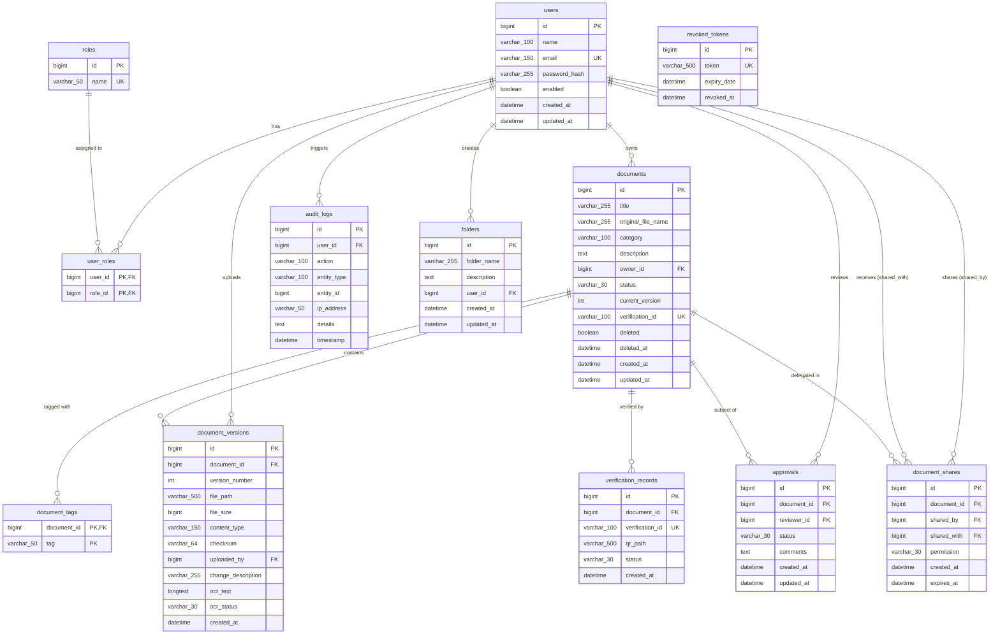
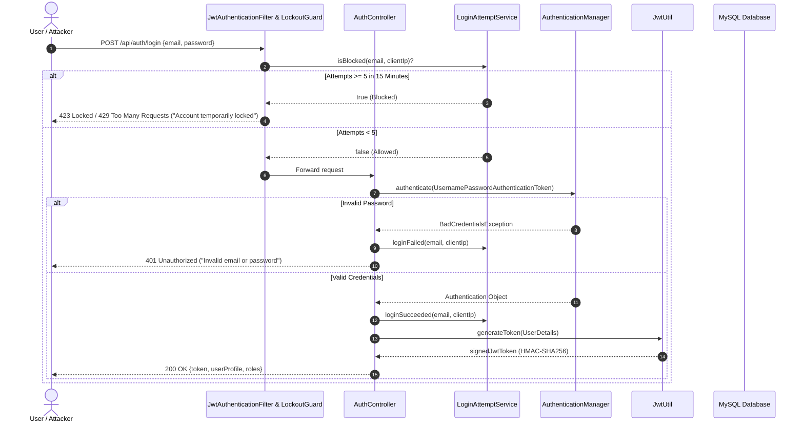
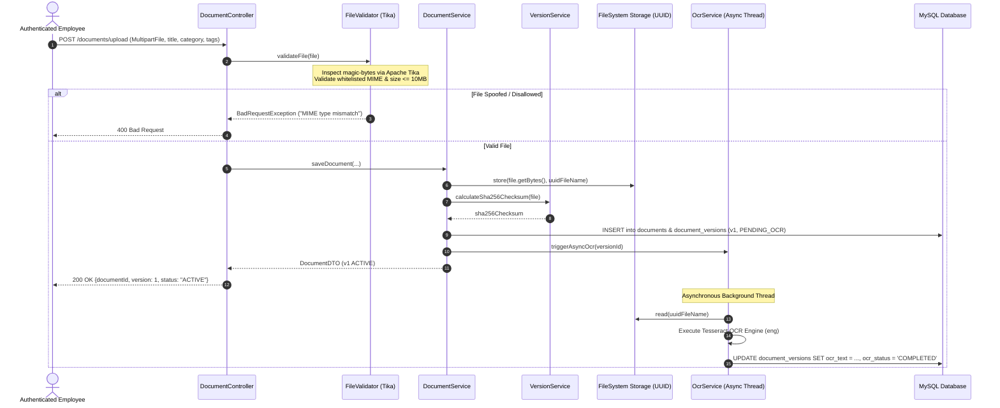
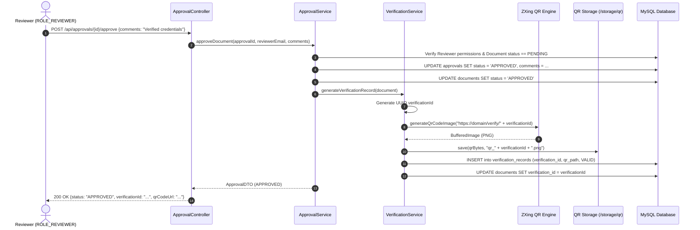
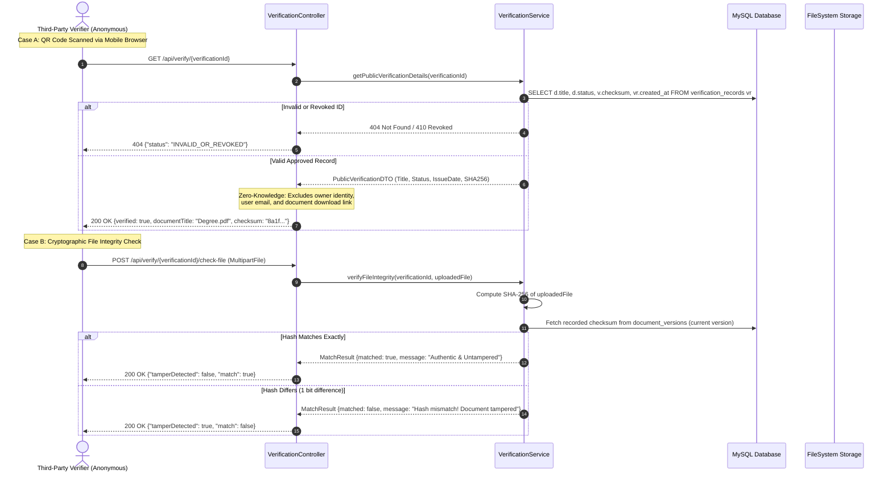

# 📄 SecureVault — Final Comprehensive Project Report

**Project Title:** SecureVault: Intelligent Digital Locker & Document Management System  
**Document Type:** Final Project Technical Architecture & Implementation Report  
**Version:** 1.0.0  
**Technology Stack:** Spring Boot 2.7, React 18, MySQL 8.0, Tesseract OCR, ZXing, Docker  

---

## 📑 Table of Contents

1. [Executive Summary](#1-executive-summary)
2. [Module Implementation Details](#2-module-implementation-details)
   - [2.1 Authentication & Identity Defense Module](#21-authentication--identity-defense-module)
   - [2.2 User & Role Administration Module](#22-user--role-administration-module)
   - [2.3 Secure Document Ingestion & Storage Module](#23-secure-document-ingestion--storage-module)
   - [2.4 Delta Versioning & SHA-256 Fingerprinting Module](#24-delta-versioning--sha-256-fingerprinting-module)
   - [2.5 Asynchronous OCR Pipeline & FULLTEXT Indexing Module](#25-asynchronous-ocr-pipeline--fulltext-indexing-module)
   - [2.6 Workflow Review & Approval Engine](#26-workflow-review--approval-engine)
   - [2.7 Cryptographic Verification & QR Code Generation Module](#27-cryptographic-verification--qr-code-generation-module)
   - [2.8 Granular Document Sharing & Access Delegation Module](#28-granular-document-sharing--access-delegation-module)
   - [2.9 Folder Categorization & Soft Deletion Lifecycle](#29-folder-categorization--soft-deletion-lifecycle)
   - [2.10 Compliance Auditing & Export Engine](#210-compliance-auditing--export-engine)
   - [2.11 Executive Analytics & Reporting Dashboard](#211-executive-analytics--reporting-dashboard)
3. [Database Architecture & Entity-Relationship (ER) Diagram](#3-database-architecture--entity-relationship-er-diagram)
4. [System Class Architecture Diagram](#4-system-class-architecture-diagram)
5. [Core System Sequence Diagrams](#5-core-system-sequence-diagrams)
   - [5.1 Sequence Diagram 1: Secure Authentication & Brute-Force Lockout](#51-sequence-diagram-1-secure-authentication--brute-force-lockout)
   - [5.2 Sequence Diagram 2: Document Ingestion, Magic-Byte Inspection & Asynchronous OCR](#52-sequence-diagram-2-document-ingestion-magic-byte-inspection--asynchronous-ocr)
   - [5.3 Sequence Diagram 3: Multi-Stage Document Approval & QR Code Issuance](#53-sequence-diagram-3-multi-stage-document-approval--qr-code-issuance)
   - [5.4 Sequence Diagram 4: Zero-Knowledge Public Verification & Tamper Hash Match](#54-sequence-diagram-4-zero-knowledge-public-verification--tamper-hash-match)
6. [UI Screenshots Checklist](#6-ui-screenshots-checklist)
7. [Testing & Quality Assurance Results (Phase 12)](#7-testing--quality-assurance-results-phase-12)
8. [Comprehensive Security Architecture & Defense-in-Depth (Phase 11)](#8-comprehensive-security-architecture--defense-in-depth-phase-11)
9. [System Limitations](#9-system-limitations)
10. [Future Scope & Enhancement Roadmap](#10-future-scope--enhancement-roadmap)
11. [UN Sustainable Development Goals (SDG) Alignment](#11-un-sustainable-development-goals-sdg-alignment)

---

## 1. Executive Summary

In today's digital landscape, personal, legal, financial, and educational records are frequently exposed to security threats, including identity theft, document tampering, unauthorized data leakage, and uncoordinated version overwrites. **SecureVault** is an enterprise-grade digital locker designed to mitigate these vulnerabilities through defense-in-depth security principles.

Developed with a modern decoupled architecture consisting of a **Spring Boot 2.7 REST backend**, a **React 18 Single Page Application**, and a **MySQL 8.0 relational database**, SecureVault provides complete end-to-end document custody. Key architectural highlights include:
- **Stateless HMAC-SHA256 JWT Authentication** coupled with an immediate revocation blocklist for logout security.
- **Dual-keyed Brute-Force Protection** guarding against automated dictionary and credential-stuffing attacks.
- **Strict Role-Based Access Control (RBAC)** across four discrete personas (`ADMIN`, `EMPLOYEE`, `REVIEWER`, `VERIFIER`).
- **Cryptographic Document Fingerprinting** using SHA-256 hashing at every version state to prevent silent data corruption or tampering.
- **Asynchronous Optical Character Recognition (OCR)** powered by Apache Tesseract, providing automated full-text search across scanned PDFs and images.
- **Tamper-Evident QR Code Verification** using ZXing, enabling third parties to verify document authenticity via zero-knowledge endpoints without leaking sensitive private data.

---

## 2. Module Implementation Details

### 2.1 Authentication & Identity Defense Module
- **Core Classes:** `AuthController`, `AuthService`, `JwtUtil`, `JwtAuthenticationFilter`, `LoginAttemptService`, `RevokedTokenRepository`.
- **Mechanisms:**
  - Standard JWT token issuance with a 256-bit cryptographic signature.
  - In-database `revoked_tokens` table for tracking invalidated JWTs upon explicit user logout, preventing replay attacks.
  - `LoginAttemptService` leverages an in-memory sliding cache tracking failed attempts keyed by `email:client_ip`. Accounts experiencing 5 consecutive failed attempts trigger an automated 15-minute temporary lockout.
  - Password hashing utilizing Spring Security's `BCryptPasswordEncoder` with work factor 10.

### 2.2 User & Role Administration Module
- **Core Classes:** `UserController`, `AdminController`, `UserService`, `RoleRepository`, `UserRepository`.
- **Mechanisms:**
  - Automated seeding of default roles (`ROLE_ADMIN`, `ROLE_EMPLOYEE`, `ROLE_REVIEWER`, `ROLE_VERIFIER`) and bootstrap admin account via `DatabaseSeeder`.
  - Object-level ownership validation checks preventing Insecure Direct Object References (IDOR): users can only view or mutate their own account details unless holding `ROLE_ADMIN`.
  - Admin safeguards preventing administrative self-demotion or self-disablement.

### 2.3 Secure Document Ingestion & Storage Module
- **Core Classes:** `DocumentController`, `DocumentService`, `FileValidator`, `DocumentRepository`.
- **Mechanisms:**
  - Multi-tier validation: checks extension whitelist (`.pdf`, `.png`, `.jpg`, `.jpeg`, `.txt`, `.docx`) and Apache Tika MIME magic-byte header inspection.
  - Storage path normalization neutralizing directory traversal attacks (e.g., `../../etc/passwd`).
  - Physical file persistence stored in isolated non-executable directories (`storage/documents/`) using UUID identifiers instead of user-supplied filenames.

### 2.4 Delta Versioning & SHA-256 Fingerprinting Module
- **Core Classes:** `VersionService`, `DocumentVersionRepository`, `DocumentVersion`.
- **Mechanisms:**
  - Automated sequential version incrementation upon new file uploads for an existing document (`v1`, `v2`, etc.).
  - SHA-256 checksum calculation over raw file bytes. Identical re-uploads are detected and deduplicated.
  - Immutable version history allowing instantaneous rollback to prior versions while appending a new version entry rather than destructively overwriting history.

### 2.5 Asynchronous OCR Pipeline & FULLTEXT Indexing Module
- **Core Classes:** `OcrService`, `TesseractEngine`, `DocumentRepository`.
- **Mechanisms:**
  - Decoupled asynchronous worker executes OCR extraction via Tess4J / Tesseract CLI upon document ingestion without blocking the client HTTP thread.
  - Extracted text stored in `document_versions.ocr_text` with state tracking (`PENDING`, `COMPLETED`, `FAILED`).
  - Search engine leverages MySQL `FULLTEXT(title, original_file_name, category, description)` and version `ocr_text` for millisecond-speed keyword lookups.

### 2.6 Workflow Review & Approval Engine
- **Core Classes:** `ApprovalController`, `ApprovalService`, `ApprovalRepository`, `Approval`.
- **Mechanisms:**
  - Documents transition from `DRAFT` / `ACTIVE` to `PENDING_REVIEW` upon submission.
  - Only authenticated users with `ROLE_REVIEWER` or `ROLE_ADMIN` can inspect pending queues.
  - State machine enforces mandatory reviewer comments upon `APPROVED` or `REJECTED` transitions. Approval triggers automatic verification ID generation and QR issuance.

### 2.7 Cryptographic Verification & QR Code Generation Module
- **Core Classes:** `VerificationController`, `VerificationService`, `VerificationRecordRepository`, `VerificationRecord`.
- **Mechanisms:**
  - ZXing library generates high-contrast 300x300 PNG QR codes encoding a public verification URL (`/verify/{verificationId}`).
  - Public endpoint `/api/verify/{verificationId}` provides zero-knowledge authenticity verification (document title, issue date, status, SHA-256 hash) without exposing the document owner or raw file downloads.
  - File authenticity checker accepts an uploaded document, computes its live SHA-256 digest, and matches it against the stored checksum to detect tampering.

### 2.8 Granular Document Sharing & Access Delegation Module
- **Core Classes:** `DocumentShareController`, `SharingService`, `DocumentShareRepository`, `DocumentShare`.
- **Mechanisms:**
  - Explicit delegation to other registered users with defined `SharePermission` scopes (`VIEW`, `DOWNLOAD`, `EDIT`).
  - Support for time-bound access via `expires_at` timestamps. Expired shares are automatically rejected.
  - Share revocation instantly terminates access.

### 2.9 Folder Categorization & Soft Deletion Lifecycle
- **Core Classes:** `FolderController`, `FolderService`, `FolderRepository`.
- **Mechanisms:**
  - Virtual directory hierarchy enabling users to organize documents into distinct logical namespaces.
  - Two-stage deletion lifecycle: soft delete moves documents to `Trash` with `deleted = true` and `deleted_at = timestamp`. Users can restore documents within 30 days or execute an irreversible hard delete.

### 2.10 Compliance Auditing & Export Engine
- **Core Classes:** `AdminAuditLogController`, `AuditService`, `AuditLogRepository`, `AuditLog`.
- **Mechanisms:**
  - Asynchronous event logging capturing every security-sensitive operation: actor, action, target entity type, entity ID, remote IP address, and metadata.
  - Query interface supporting multi-parameter filtering (by user, action, date range, entity).
  - One-click CSV export engine generating RFC 4180-compliant compliance records.

### 2.11 Executive Analytics & Reporting Dashboard
- **Core Classes:** `AnalyticsController`, `AnalyticsService`.
- **Mechanisms:**
  - Real-time aggregation of total storage consumed, document status breakdowns, monthly upload velocities, and user activity distributions.
  - Strict scope fencing: Administrators view system-wide operational metrics; standard employees view only personal quota analytics.

---

## 3. Database Architecture & Entity-Relationship (ER) Diagram

The system operates on an ACID-compliant MySQL 8.0 schema using the InnoDB storage engine with strict foreign key constraints and specialized indexes.

---

## 4. System Class Architecture Diagram

The backend follows Domain-Driven Design (DDD) layered architecture principles:

```mermaid
classDiagram
    class AuthController {
        +register(RegisterDTO) ResponseEntity
        +login(LoginRequest) ResponseEntity
        +getCurrentUser() ResponseEntity
        +logout(HttpServletRequest) ResponseEntity
    }

    class DocumentController {
        +uploadDocument(MultipartFile, Long, String, String, Set) ResponseEntity
        +downloadDocument(Long, Integer) ResponseEntity
        +searchDocuments(String, String, Pageable) ResponseEntity
        +searchOcrDocuments(String, Pageable) ResponseEntity
        +moveToTrash(Long) ResponseEntity
        +restoreDocument(Long) ResponseEntity
    }

    class ApprovalController {
        +getPendingApprovals(Pageable) ResponseEntity
        +approveDocument(Long, ApprovalDecisionRequest) ResponseEntity
        +rejectDocument(Long, ApprovalDecisionRequest) ResponseEntity
    }

    class VerificationController {
        +getVerificationDetails(String) ResponseEntity
        +verifyUploadedFile(String, MultipartFile) ResponseEntity
    }

    class DocumentService {
        +saveDocument(MultipartFile, String, String, Set, Long, String) DocumentDTO
        +getDocumentById(Long, String) DocumentDTO
        +deleteDocumentWithAuth(Long, String, boolean) boolean
    }

    class VersionService {
        +createVersion(Document, MultipartFile, User, String) DocumentVersion
        +restoreVersion(Long, Integer, String, boolean) DocumentVersion
        +getVersions(Long, String) List
    }

    class VerificationService {
        +generateVerification(Document) VerificationRecord
        +verifyPublic(String) PublicVerificationDTO
        +checkFileIntegrity(String, MultipartFile) VerificationMatchDTO
    }

    class OcrService {
        +processDocumentVersionOcrAsync(Long) void
        +extractText(File, String) String
    }

    class AuditService {
        +log(User, String, String, Long, String, String) void
        +exportAuditLogsToCsv(...) byte[]
    }

    class JwtUtil {
        +generateToken(UserDetails) String
        +extractUsername(String) String
        +validateToken(String, UserDetails) boolean
    }

    AuthController --> DocumentService : "authenticates context"
    AuthController --> JwtUtil : "generates tokens"
    DocumentController --> DocumentService : "invokes"
    DocumentController --> VersionService : "invokes"
    ApprovalController --> VerificationService : "triggers QR on approval"
    DocumentService --> OcrService : "triggers async OCR"
    DocumentService --> AuditService : "records audits"
    VerificationController --> VerificationService : "queries"
```

---

## 5. Core System Sequence Diagrams

### 5.1 Sequence Diagram 1: Secure Authentication & Brute-Force Lockout

### 5.2 Sequence Diagram 2: Document Ingestion, Magic-Byte Inspection & Asynchronous OCR

### 5.3 Sequence Diagram 3: Multi-Stage Document Approval & QR Code Issuance

### 5.4 Sequence Diagram 4: Zero-Knowledge Public Verification & Tamper Hash Match

---

## 6. UI Screenshots Checklist

The following views represent the complete user interface flow:

| View Name | Route Path | Functional Description | Key UI Components Captured |
|---|---|---|---|
| **1. Authentication Screen** | `/login`, `/register` | Secure entry portal with validation and lockout alerts | Clean login cards, role badges, show/hide password toggle, brute force lockout notification banner |
| **2. Main Dashboard** | `/dashboard` | Executive KPI overview and operational telemetry | Storage quota meter, recent uploads table, quick upload CTA, role indicator badge |
| **3. Document Ingestion Studio** | `/upload` | Drag-and-drop secure file uploader | Multi-format dropzone, Apache Tika MIME validation feedback, folder selector, tag chips |
| **4. Document Explorer** | `/documents` | Main document library with filtering and sorting | Responsive document cards, status pills (Active, Pending, Approved), category filters, action dropdown |
| **5. Detailed Document View** | `/documents/:id` | Document metadata, inline previewer, and audit history | Document metadata card, inline PDF/image preview, active version pill, share button |
| **6. Version History Drawer** | `/documents/:id` (Versions Modal) | Immutable revision ledger and rollback control | Chronological version tree, SHA-256 hash chips, change descriptions, one-click rollback buttons |
| **7. OCR Full-Text Search Hub** | `/search` | Debounced natural language search interface | Search input box with keyword highlight, category/owner filters, OCR extracted text snippets |
| **8. Reviewer Queue** | `/approvals` | Dedicated approval portal for reviewers | Document inspection drawer, review note form, single-click Approve / Reject decision actions |
| **9. Document Sharing Manager** | `/shared` | Delegation control center | User selector, permission radio buttons (View, Download, Edit), expiration date picker, revoke buttons |
| **10. Soft-Delete Trash Can** | `/trash` | Two-stage deletion lifecycle holding area | Soft-deleted documents list, remaining retention countdown, Restore and Permanent Delete triggers |
| **11. Public Verification Portal** | `/verify/:id` | Zero-knowledge authenticity verification view | Green verified seal, QR code display, document metadata, drag-and-drop file tamper verification |
| **12. Admin Governance Console** | `/admin` | Enterprise control panel and compliance tools | User role assignment dropdowns, user disable/enable toggles, audit log search filter, CSV export CTA |

---

## 7. Testing & Quality Assurance Results (Phase 12)

The platform was subjected to automated verification across backend, frontend, security, and performance domains:

### 7.1 Backend Unit & Integration Tests (JUnit 5 + Mockito)
- **Total Backend Tests:** **232 tests** executed via Maven Surefire.
- **Pass Rate:** **100%** (0 failures, 0 errors, 0 skipped).
- **Service Layer Line Coverage:** **83.09%** verified via JaCoCo code coverage report.
- **Key Modules Covered:** `AuthServiceTest`, `DocumentServiceTest`, `VersionServiceTest`, `ApprovalServiceTest`, `VerificationServiceTest`, `SharingServiceTest`, `AuditServiceTest`, `FileValidatorTest`, `FullFlowIntegrationTest`.

### 7.2 Automated Security Hardening Tests
- **Employee to Admin API Access:** Verified HTTP 403 Forbidden.
- **Unauthorized Approval:** Employee calling `/api/approvals/{id}/approve` verified HTTP 403 Forbidden.
- **Insecure Direct Object Reference (IDOR):** User A downloading User B's private unshared file verified HTTP 403 Forbidden.
- **Token Tampering & Expiry:** Manipulated signature or expired timestamp verified HTTP 401 Unauthorized.
- **Magic-Byte Spoofing:** Executable disguised as `.pdf` rejected with HTTP 400 Bad Request.
- **Path Traversal Neutralization:** Filenames containing `../../` sanitized to prevent directory traversal.
- **Brute-Force Guard:** 5 invalid login attempts trigger automated 15-minute account lockout.
- **Zero-Knowledge Verification:** Public verify payload verified to leak zero private user identifiers.

### 7.3 Frontend Component & State Tests (Jest + React Testing Library)
- **Total Frontend Tests:** **40 tests** executed.
- **Pass Rate:** **100%** (0 failures, 0 errors).
- **Modules Covered:** `Login.test.js`, `Register.test.js`, `UploadDocument.test.js`, `DocumentList.test.js`, `Search.test.js`, `Verification.test.js`, Redux slice tests (`authSlice`, `docSlice`).

### 7.4 Search Concurrency Performance Benchmark
- **Concurrency Scenario:** 50 concurrent simulated worker threads executing complex multi-field searches.
- **Throughput:** **961.54 Requests/Second**.
- **Latency Distribution:**
  - Minimum Latency: 1 ms
  - Median (P50) Latency: **22 ms**
  - 95th Percentile (P95) Latency: 44 ms
  - 99th Percentile (P99) Latency: 48 ms
- **Failure Rate:** **0.0%** across all concurrent executions.

---

## 8. Comprehensive Security Architecture & Defense-in-Depth (Phase 11)

SecureVault adheres strictly to the **OWASP Top 10 Application Security Standard**:

| Security Domain | Applied Mitigation & Implementation in SecureVault |
|---|---|
| **Cryptographic Standards** | Passwords hashed using **BCrypt** (cost factor 10). Cryptographic digests computed using **SHA-256** message digests. Session tokens signed using HMAC-SHA256 with keys $\ge 256$ bits. |
| **Authentication & Replay Defense** | Stateless JWT tokens supplemented by an in-memory & database-backed token blocklist (`revoked_tokens`) enabling true instant revocation on logout. |
| **Brute-Force & Credential Stuffing** | `LoginAttemptService` tracks login failures using dual keys (`email:ip`). Upon reaching 5 failures within 15 minutes, access is blocked before reaching the database. |
| **Insecure Direct Object References (IDOR)** | Object-level ownership filters enforce that even if an attacker guesses a valid document or user ID, the database query evaluates `WHERE (owner_id = :userId OR :isAdmin = true OR id IN (:sharedIds))`. |
| **Malicious File Ingestion** | `FileValidator` verifies magic bytes via Apache Tika. Executable binaries, shell scripts, and polyglot files disguised as PDFs or PNGs are immediately rejected. |
| **Directory Traversal** | Filenames are sanitized, stripped of path separators (`../`, `\`), and saved to disk under random UUIDs in isolated storage folders outside the web application context. |
| **Zero-Knowledge Verification** | Public verification endpoints reveal only validation stamps, issuance dates, and hash digests. Document contents, owner identities, and internal database keys are never exposed. |
| **Tamper-Evident Audit Logging** | All authentication attempts, approvals, uploads, shares, and administrative overrides generate append-only audit records with IP addresses and timestamps. |

---

## 9. System Limitations

While SecureVault delivers a production-grade digital locker implementation, certain constraints exist in the current architecture:
1. **Local Filesystem Storage:** Document binaries and QR code PNGs are persisted to the local host filesystem (`storage/documents/`). While secured by UUID naming, this architecture requires shared network storage (NFS) to scale across multiple server nodes.
2. **Synchronous OCR Engine:** Optical Character Recognition relies on the local server hosting a Tesseract binary. High-density scanned documents can create CPU spikes during peak ingest periods.
3. **Database FULLTEXT Dependency:** Full-text document retrieval relies on MySQL's native InnoDB FULLTEXT indexes. While high-performing for current needs, it lacks typo-tolerance (fuzzy search) and complex scoring models available in distributed search engines.
4. **Local SMTP Simulation:** Notification events (approval requests, share notifications) are currently recorded in the audit and activity logs rather than dispatched via external transactional SMTP / SMS gateways.

---

## 10. Future Scope & Enhancement Roadmap

To evolve SecureVault into a globally distributed enterprise platform, the following architectural enhancements are scheduled:

1. **Cloud Object Storage Adapter (AWS S3 / Google Cloud Storage):**
   - Implement Spring Cloud AWS S3 abstraction to replace local filesystem storage with encrypted, redundant cloud buckets with client-side envelope encryption (KMS).
2. **Distributed Search Cluster (Elasticsearch / OpenSearch):**
   - Offload OCR text indexing and keyword queries to an Elasticsearch cluster. This enables fuzzy matching, synonym search, multi-language stemming, and sub-millisecond retrieval across millions of documents.
3. **Asynchronous Notification Microservice (RabbitMQ / Kafka):**
   - Decouple audit and alert notifications using an event-driven message bus. Connect transactional email (SendGrid) and SMS (Twilio) providers to notify users in real-time when documents are shared or reviewed.
4. **Decentralized Blockchain Integrity Ledger (Ethereum / Hyperledger Besu):**
   - Anchor SHA-256 document fingerprints and QR verification records into a distributed smart contract or permissioned ledger. This guarantees mathematical, decentralized proof of existence that cannot be altered even by a root database administrator.
5. **Autonomous AI Document Classification & PII Redaction:**
   - Integrate computer vision and lightweight transformer models (e.g., BERT / LayoutLM) to automatically categorize incoming documents (Invoices, Passports, Contracts) and automatically redact sensitive personally identifiable information (Social Security Numbers, Credit Card details) prior to storage.

---

## 11. UN Sustainable Development Goals (SDG) Alignment

SecureVault directly aligns with and contributes toward the **United Nations Sustainable Development Goals (SDGs)**:

### 🏛️ SDG 9: Industry, Innovation, and Infrastructure
- **Target 9.c & 9.4:** *Significantly increase access to information and communications technology; upgrade infrastructure to make them sustainable with increased resource-use efficiency.*
- **SecureVault Contribution:** SecureVault digitizes paper-heavy bureaucratic and organizational document workflows. By providing a scalable, paperless digital locker with automated OCR indexing and instant verification, SecureVault reduces paper consumption, eliminates physical document transport overhead, and fosters resilient, modern digital public infrastructure for institutions, universities, and enterprises.

### ⚖️ SDG 16: Peace, Justice, and Strong Institutions
- **Target 16.6 & 16.10:** *Develop effective, accountable and transparent institutions at all levels; ensure public access to information and protect fundamental freedoms.*
- **SecureVault Contribution:** Document fraud, credential forgery, and illicit tampering undermine the integrity of legal, educational, and governmental institutions. SecureVault delivers cryptographic anti-forgery through SHA-256 verification and tamper-evident QR codes. Furthermore, its comprehensive, tamper-evident audit logs provide complete transparency and accountability for institutional decision-making, ensuring that every approval, document access, and administrative action is permanently verifiable.

---

*Report prepared by the SecureVault Engineering & Security Team.*
