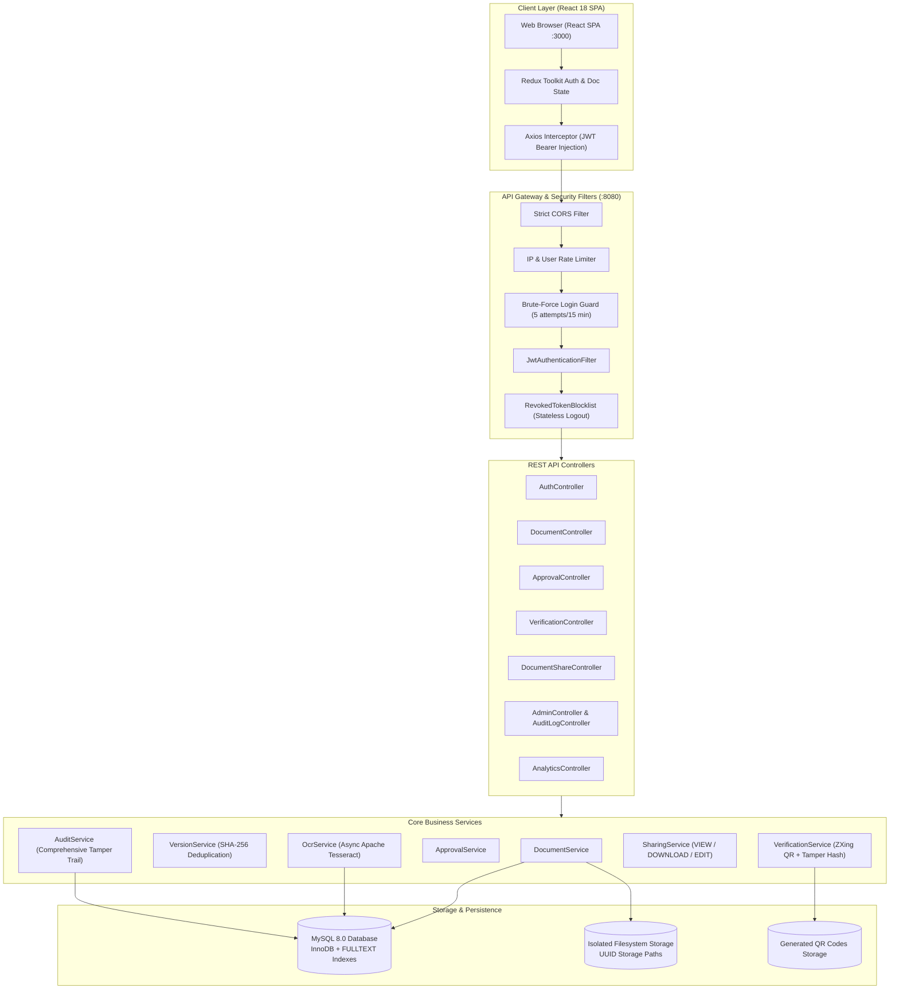

# 🔐 SecureVault — Intelligent Digital Locker & Document Management System

[](https://www.oracle.com/java/)
[](https://spring.io/projects/spring-boot)
[](https://reactjs.org/)
[](https://www.mysql.com/)
[](LICENSE)
[]()
[]()
[]()

> **SecureVault** is an enterprise-grade, secure digital locker and document management platform engineered with defense-in-depth principles. It offers end-to-end document lifecycle management: cryptographic SHA-256 integrity checks, immutable version history, Apache Tesseract OCR indexing with MySQL FULLTEXT search, role-based approval workflows, tamper-evident QR code issuance, and zero-knowledge public verification.

---

## 📑 Table of Contents

- [System Architecture](#-system-architecture)
- [Key Features](#-key-features)
- [Technology Stack](#-technology-stack)
- [Default Seed Accounts & RBAC Matrix](#-default-seed-accounts--rbac-matrix)
- [Getting Started](#-getting-started)
  - [Prerequisites](#prerequisites)
  - [Local Development Setup](#local-development-setup)
  - [Docker Compose Quickstart](#docker-compose-quickstart)
- [Environment Configuration](#-environment-configuration)
- [API Documentation & Swagger UI](#-api-documentation--swagger-ui)
- [Project Directory Structure](#-project-directory-structure)
- [Testing & Quality Assurance](#-testing--quality-assurance)
- [Security Architecture](#-security-architecture)
- [UI Screenshots](#-ui-screenshots)
- [Product Roadmap](#-product-roadmap)

---

## 🏛️ System Architecture



---

## ✨ Key Features

1. **Authentication & Identity Defense:**
   - Stateless JWT authentication signed with HMAC-SHA256 (`>= 256-bit` secret).
   - In-database token blocklist (`revoked_tokens`) for instantaneous logout invalidation.
   - Dual-keyed brute-force lockout (`email:ip`) locking accounts for 15 minutes after 5 failed attempts.
   - BCrypt hashing with strength cost factor 10.

2. **Strict Role-Based Access Control (RBAC):**
   - Four distinct personas: `ADMIN`, `EMPLOYEE`, `REVIEWER`, and `VERIFIER`.
   - Admin safeguards preventing accidental self-lockout or self-demotion.
   - Method-level security via Spring `@PreAuthorize` coupled with object-level ownership checks preventing IDOR.

3. **Secure Document Ingestion:**
   - Multi-stage validation: File extension whitelist + Apache Tika MIME magic-byte header inspection.
   - Content sanitization: Filename normalization preventing Path Traversal (`../`).
   - Storage isolation: Files saved as random UUIDs outside web root (`storage/documents/`).

4. **Immutable Version Control:**
   - Automatic delta versioning on document updates.
   - SHA-256 checksum fingerprinting per version.
   - One-click rollback to prior versions with automatic version chain preservation.

5. **OCR Pipeline & Full-Text Search:**
   - Asynchronous OCR extraction powered by Apache Tesseract (`eng`).
   - Natural language and keyword search utilizing MySQL `FULLTEXT` indexing on extracted text, title, and tags.
   - Permission-aware search results ensuring private files never leak in search results.

6. **Workflow Approvals & Reviewer Gatekeeping:**
   - Multi-step approval state machine: `PENDING` -> `APPROVED` or `REJECTED`.
   - Immutable comments log for auditability.
   - Immediate triggering of QR generation upon reviewer approval.

7. **Cryptographic Verification & Tamper-Evident QR:**
   - ZXing QR generation embedding a tamper-proof verification URL: `/verify/{verificationId}`.
   - Zero-Knowledge public verification endpoint leaking no private owner identifiers or file contents.
   - Public file-authenticity check: upload any file to compare its SHA-256 against the recorded hash.

8. **Fine-Grained Document Sharing:**
   - Granular delegation: `VIEW`, `DOWNLOAD`, or `EDIT` permissions.
   - Time-bound sharing with optional expiration timestamps.
   - Immediate access revocation by the document owner or system admin.

9. **Folder Organization & Soft Deletion:**
   - Hierarchical folder categorization.
   - Two-stage lifecycle: Soft delete to `Trash` with 30-day restore capability, followed by irreversible permanent purge.

10. **Auditing, Compliance & Analytics:**
    - Tamper-evident audit logging recording Actor, Action, Entity, IP address, and Timestamp.
    - One-click CSV export of audit trails for compliance reporting.
    - Rich executive dashboards with monthly trends, category charts, and storage quotas.

---

## 🛠️ Technology Stack

| Layer | Technology | Version | Purpose |
|---|---|---|---|
| **Frontend** | React.js | 18.2.0 | Reactive Single Page Application |
| | Redux Toolkit | 1.9.7 | Centralized state management (Auth, Docs, Folders) |
| | React Router DOM | 6.30.1 | Client-side routing with role-based Route Guards |
| | Axios | 1.11.0 | HTTP client with automatic JWT Bearer interceptor |
| | Lucide React | 0.544.0 | Modern UI icon library |
| | Recharts | 3.10.1 | Data visualization for executive analytics |
| **Backend** | Spring Boot | 2.7.0 | Enterprise Java REST Framework |
| | Spring Security | 5.7.1 | Security filter chain, RBAC, method security |
| | Java | 11 / 17 | Core platform language |
| | Spring Data JPA | 2.7.0 | ORM layer (Hibernate 5) |
| | JJWT (io.jsonwebtoken) | 0.9.1 | JWT generation, signing, and verification |
| | Apache Tika | 2.8.0 | Magic-byte MIME type validation |
| | Tess4J / Tesseract | 5.7.0 / 4.x+ | Optical Character Recognition (OCR) engine |
| | ZXing (Zebra Crossing) | 3.5.1 | QR code generation & encoding |
| | springdoc-openapi | 1.6.15 | OpenAPI 3.0 & Swagger UI documentation |
| **Database** | MySQL | 8.0 | Relational database with InnoDB FULLTEXT indexes |
| **Testing** | JUnit 5 & Mockito | 5.8.2 / 4.5.1 | Backend unit & integration test framework |
| | JaCoCo | 0.8.10 | Code coverage analysis (83.09% on service package) |
| | Jest & RTL | 27.5.1 / 13.4.0 | Frontend component & state testing |
| **DevOps** | Docker & Compose | 3.8 | Multi-container orchestration |

---

## 👥 Default Seed Accounts & RBAC Matrix

The system seeds standard accounts on first launch via [`DatabaseSeeder.java`](file:///Users/mahesh/Desktop/digital-locker-system-main/springapp/src/main/java/com/securevault/config/DatabaseSeeder.java):

| Role | Default Email | Password | Permissions & Scope |
|---|---|---|---|
| `ADMIN` | `admin@securevault.com` | `Admin@12345` | Global system control, user role management, account lock/unlock, global audit log query, CSV export, view all system documents. |
| `EMPLOYEE` | *Registered via `/register`* | *User defined* | Upload documents, manage personal folders, edit/version own docs, share docs with specific permissions, move to trash. |
| `REVIEWER` | *Promoted by Admin* | *Assigned* | Review submitted documents, approve/reject pending submissions with mandatory review notes, trigger QR issuance. |
| `VERIFIER` | *Promoted by Admin* | *Assigned* | Inspect approved document records, perform cryptographic file hash matches, verify QR codes. |

### RBAC Permission Matrix

| Capability | ADMIN | EMPLOYEE | REVIEWER | VERIFIER | Public (Anon) |
|---|:---:|:---:|:---:|:---:|:---:|
| User Registration & Login | ✅ | ✅ | ✅ | ✅ | ✅ |
| Upload & Version Documents | ✅ | ✅ | ❌ | ❌ | ❌ |
| View / Download Own Documents | ✅ | ✅ | ❌ | ❌ | ❌ |
| View Shared Documents | ✅ | ✅ | ✅ | ✅ | ❌ |
| Approve / Reject Documents | ✅ | ❌ | ✅ | ❌ | ❌ |
| Issue & Revoke QR Codes | ✅ | ❌ | ✅ | ❌ | ❌ |
| Zero-Knowledge Public Verification | ✅ | ✅ | ✅ | ✅ | ✅ |
| Manage User Roles & Accounts | ✅ | ❌ | ❌ | ❌ | ❌ |
| Export Audit Trail CSV | ✅ | ❌ | ❌ | ❌ | ❌ |
| View Analytics Dashboards | ✅ | ✅ (Own) | ✅ (Own) | ❌ | ❌ |

---

## 🚀 Getting Started

### Prerequisites

Ensure you have the following installed on your machine:
- **Java Development Kit (JDK):** Version 11 or 17 (`java -version`)
- **Apache Maven:** Version 3.8+ (`mvn -version`)
- **Node.js:** Version 16+ or 18+ and `npm` (`node -v`, `npm -v`)
- **MySQL Server:** Version 8.0+ running locally on port 3306
- **Tesseract OCR (Optional for local non-Docker OCR):** `tesseract` binary installed (`brew install tesseract` on macOS, `apt install tesseract-ocr` on Ubuntu)

---

### Local Development Setup

#### Step 1: Database Initialization
Open your MySQL terminal or GUI client (Workbench, DBeaver) and create the database:
```sql
CREATE DATABASE document_management CHARACTER SET utf8mb4 COLLATE utf8mb4_unicode_ci;
```

#### Step 2: Environment Configuration
Copy `.env.example` in the root folder to `.env` or set the environment variables in your terminal:
```bash
cp .env.example .env
```
Ensure your database credentials match `springapp/src/main/resources/application.properties`:
```properties
spring.datasource.url=jdbc:mysql://localhost:3306/document_management?useSSL=false&serverTimezone=UTC&allowPublicKeyRetrieval=true
spring.datasource.username=root
spring.datasource.password=your_mysql_password
```

#### Step 3: Run the Spring Boot Backend
Navigate to the backend directory and launch the application:
```bash
cd springapp
mvn clean spring-boot:run
```
- The backend initializes on port `8080`.
- The database schema is automatically updated via Hibernate.
- Default roles (`ADMIN`, `EMPLOYEE`, `REVIEWER`, `VERIFIER`) and the seed admin account are inserted.
- Verify backend health: Open `http://localhost:8080/swagger-ui` in your browser.

#### Step 4: Run the React Frontend
Open a new terminal window, navigate to the frontend directory, install dependencies, and start the development server:
```bash
cd reactapp
npm install --legacy-peer-deps
npm start
```
- The frontend will automatically launch at `http://localhost:3000`.
- You can now log in using `admin@securevault.com` / `Admin@12345` or register a new Employee account.

---

### Docker Compose Quickstart

To run the entire multi-tier stack (MySQL 8.0 + Spring Boot + Nginx React SPA) with a single command without installing JDK, Maven, or MySQL locally:

```bash
docker-compose up --build -d
```

- **Frontend SPA:** `http://localhost:3000`
- **Backend API:** `http://localhost:8080`
- **Swagger Documentation:** `http://localhost:8080/swagger-ui/`
- **MySQL Database:** `localhost:3306`

To shut down the cluster and clean up containers:
```bash
docker-compose down
```

---

## ⚙️ Environment Configuration

All configurable properties in the system can be customized via environment variables:

| Variable Name | Default Value | Description |
|---|---|---|
| `DB_URL` | `jdbc:mysql://localhost:3306/document_management...` | JDBC database connection string |
| `DB_USERNAME` | `root` | MySQL database username |
| `DB_PASSWORD` | `rootpassword` | MySQL database password |
| `JWT_SECRET` | *(256-bit Base64 Key)* | HMAC-SHA256 signing key (must be $\ge$ 256 bits) |
| `JWT_EXPIRATION` | `3600000` (1 hour) | Token validity lifetime in milliseconds |
| `CORS_ALLOWED_ORIGINS`| `http://localhost:3000` | Comma-separated allowed frontend origins |
| `ADMIN_NAME` | `Admin User` | Seed administrator display name |
| `ADMIN_EMAIL` | `admin@securevault.com` | Seed administrator login email |
| `ADMIN_PASSWORD` | `Admin@12345` | Seed administrator initial password |
| `UPLOAD_DIR` | `storage/documents` | Storage folder for uploaded documents |
| `QR_DIR` | `storage/qr` | Storage folder for generated QR PNGs |
| `MAX_DOC_SIZE` | `10485760` (10 MB) | Max file upload size limit |
| `MAX_IMAGE_SIZE` | `5242880` (5 MB) | Max image upload size limit |
| `MAX_LOGIN_ATTEMPTS` | `5` | Maximum failed logins before temporary lockout |
| `LOCKOUT_DURATION_MINUTES` | `15` | Brute force lockout cooldown window |
| `OCR_ENABLED` | `true` | Enable/disable background Tesseract OCR worker |
| `TESSDATA_PREFIX` | `storage/tessdata` | Path to Tesseract trained language models |

---

## 📖 API Documentation & Swagger UI

SecureVault includes complete OpenAPI 3.0 specification documents and interactive Swagger UI:

- **Interactive Swagger UI:** [`http://localhost:8080/swagger-ui`](http://localhost:8080/swagger-ui)
- **Raw OpenAPI 3.0 JSON:** [`http://localhost:8080/v3/api-docs`](http://localhost:8080/v3/api-docs)
- **Repository Export:** Stored directly in the project at [`openapi.json`](file:///Users/mahesh/Desktop/digital-locker-system-main/openapi.json) and [`docs/openapi.json`](file:///Users/mahesh/Desktop/digital-locker-system-main/docs/openapi.json).
- **Postman Collection:** [`postman/SecureVault.postman_collection.json`](file:///Users/mahesh/Desktop/digital-locker-system-main/postman/SecureVault.postman_collection.json)

### Using Swagger UI with JWT Bearer Authentication
1. Navigate to `http://localhost:8080/swagger-ui`.
2. Expand the `1. Authentication` section and call `POST /api/auth/login` with your credentials.
3. Copy the returned `token` string from the JSON response.
4. Click the green **Authorize 🔓** button at the top right of the Swagger UI page.
5. Paste the token into the `Value:` box and click **Authorize**.
6. All subsequent requests in Swagger UI will automatically attach the `Authorization: Bearer <token>` header.

---

## 📁 Project Directory Structure

```
digital-locker-system-main/
├── docker-compose.yml              # Multi-container Docker orchestration
├── .env.example                    # Environment variable template
├── openapi.json                    # Exported OpenAPI 3.0 schema
├── TEST_DOCUMENTATION.md           # Comprehensive test execution & coverage report
├── DEMO_SCRIPT.md                  # 8-10 minute live presentation guide
├── VIVA_QA.md                      # 25 viva questions & answers
├── FINAL_PROJECT_REPORT.md         # Final academic & project documentation
│
├── springapp/                      # Spring Boot 2.7 REST API Backend
│   ├── pom.xml                     # Maven project descriptor & dependencies
│   ├── Dockerfile                  # Multi-stage JDK 17 + Tesseract OCR build
│   └── src/
│       ├── main/java/com/securevault/
│       │   ├── config/             # AppConfig, OpenApiConfig, DatabaseSeeder
│       │   ├── controller/         # 11 REST Controllers (Auth, Doc, Approval, etc.)
│       │   ├── dto/                # Data Transfer Objects & validation annotations
│       │   ├── entity/             # JPA Entities (User, Role, Document, Version, etc.)
│       │   ├── exception/          # GlobalExceptionHandler & custom exceptions
│       │   ├── repository/         # Spring Data JPA Repositories (10 interfaces)
│       │   ├── security/           # JwtFilter, SecurityConfig, BruteForceGuard
│       │   └── service/            # Core business logic services & OCR pipeline
│       └── test/java/com/securevault/
│           ├── controller/         # WebMvc slice controller tests
│           ├── performance/        # 50-thread concurrent search benchmark
│           ├── security/           # RBAC, Lockout, and IDOR defense tests
│           └── service/            # Service unit tests (MockMvc + Mockito)
│
├── reactapp/                       # React 18 Single Page Application
│   ├── package.json                # Node dependencies & test scripts
│   ├── Dockerfile                  # Multi-stage Node build + Nginx alpine
│   ├── nginx.conf                  # Nginx reverse proxy configuration
│   ├── public/                     # Static assets & index.html
│   └── src/
│       ├── components/             # Reusable UI components (Navbar, Sidebar, Modal)
│       ├── context/                # AuthContext & React Context providers
│       ├── pages/                  # 12 Application views (Login, Upload, Verify, etc.)
│       ├── redux/                  # Redux Toolkit slices (authSlice, docSlice)
│       ├── services/               # Axios API service clients
│       └── setupTests.js           # Jest DOM matchers & mock setups
│
├── docs/                           # Documentation artifacts
└── postman/                        # Postman collection & environment files
```

---

## 🧪 Testing & Quality Assurance

The codebase includes an automated test harness covering backend unit, integration, and security tests, as well as frontend component tests.

### Test Execution Commands

```bash
# Execute all backend tests & generate JaCoCo report
cd springapp
mvn clean test

# Execute 50-thread concurrency performance benchmark
mvn test -Dtest=ConcurrentSearchPerformanceTest

# Execute all frontend Jest & React Testing Library tests
cd ../reactapp
npm test -- --watchAll=false
```

### Coverage & Test Metrics
- **Total Backend Tests:** 232 passed (0 failures, 0 errors, 0 skipped).
- **Service Layer Line Coverage:** **83.09%** verified via JaCoCo.
- **Total Frontend Tests:** 40 passed across components, routing, and state slices.
- **Search Concurrency Benchmark:** 50 concurrent threads achieved **961.54 RPS** with **22 ms** median latency and **0% error rate**.

For in-depth analysis, refer to [`TEST_DOCUMENTATION.md`](file:///Users/mahesh/Desktop/digital-locker-system-main/TEST_DOCUMENTATION.md).

---

## 🛡️ Security Architecture

SecureVault implements OWASP Top 10 mitigation strategies:

1. **A01: Broken Access Control:**
   - Object-level ownership validation checks (`owner.email == auth.getName() || isAdmin`) on all file mutations, version rollbacks, and profile updates.
2. **A02: Cryptographic Failures:**
   - Passwords hashed with BCrypt.
   - Files fingerprinted using SHA-256 digests.
   - JWT tokens signed with HMAC-SHA256.
3. **A03: Injection:**
   - All queries parameterized via Spring Data JPA.
   - MySQL FULLTEXT searches sanitized against query injection.
4. **A04: Insecure Design:**
   - Zero-Knowledge public verification endpoint reveals only authenticity status, timestamp, and non-sensitive metadata—no private user information or raw document downloads.
5. **A05: Security Misconfiguration:**
   - Custom `AccessDeniedHandler` and `AuthenticationEntryPoint` return standardized JSON errors without leaking stack traces or internal server paths.
6. **A07: Identification and Authentication Failures:**
   - Dual-keyed IP + Email brute force lockout blocks automated dictionary attacks after 5 incorrect credentials.
   - Token blocklist ensures immediate revocation on logout.

---

## 📸 UI Screenshots

*(Placeholders for presentation slides and project manuals)*

| Screen View | Description | Key Elements Captured |
|---|---|---|
| **1. Login & MFA Guard** | User login screen with lockout warning | Email/password form, register redirect, validation errors |
| **2. Executive Dashboard** | Real-time overview of locker storage | Storage quota gauge, recent activity feed, quick upload |
| **3. Secure Upload Studio** | File ingestion with drag-and-drop | Tika MIME detection, tag selector, folder assignment |
| **4. Document Explorer** | Paginated grid & list view | Status pills (Pending, Approved), category tags, action menu |
| **5. Version History Modal** | Version tree with rollback | SHA-256 hashes, author email, version timestamps, revert button |
| **6. Full-Text Search Hub** | OCR text & keyword search | Instant debounce query, category filters, highlighted excerpts |
| **7. Reviewer Approval Queue**| Dedicated reviewer dashboard | Document preview modal, comment drawer, Approve/Reject buttons |
| **8. Public Verification Portal**| Zero-knowledge verification | QR reader, authenticity badge, SHA-256 file drop verification |
| **9. Admin Control Panel** | User management & audit logs | Role modifier dropdown, user lock switch, CSV export button |

---

## 🗺️ Product Roadmap

- [x] Phase 1–11: Core Locker, OCR Pipeline, Approvals, QR Verification, Security Hardening.
- [x] Phase 12: Automated Test Suites (JUnit 5, Mockito, RTL) & JaCoCo coverage $\ge$ 83%.
- [x] Phase 13: Search concurrency performance optimization & benchmark.
- [x] Phase 14: OpenAPI 3.0 documentation, Docker orchestration, and presentation materials.
- [ ] **Phase 15 (Future):** Cloud Object Storage Adapter (AWS S3 / Google Cloud Storage).
- [ ] **Phase 16 (Future):** Distributed Search Cluster (Elasticsearch / OpenSearch).
- [ ] **Phase 17 (Future):** Asynchronous Email & SMS Notifications via RabbitMQ/Kafka.
- [ ] **Phase 18 (Future):** Decentralized Document Integrity Ledger via Ethereum/Polygon Smart Contracts.
- [ ] **Phase 19 (Future):** Autonomous AI Document Classification using Local LLM / Vision Models.

---

## 📄 License

This project is licensed under the Apache License 2.0. See the [LICENSE](LICENSE) file for details.
